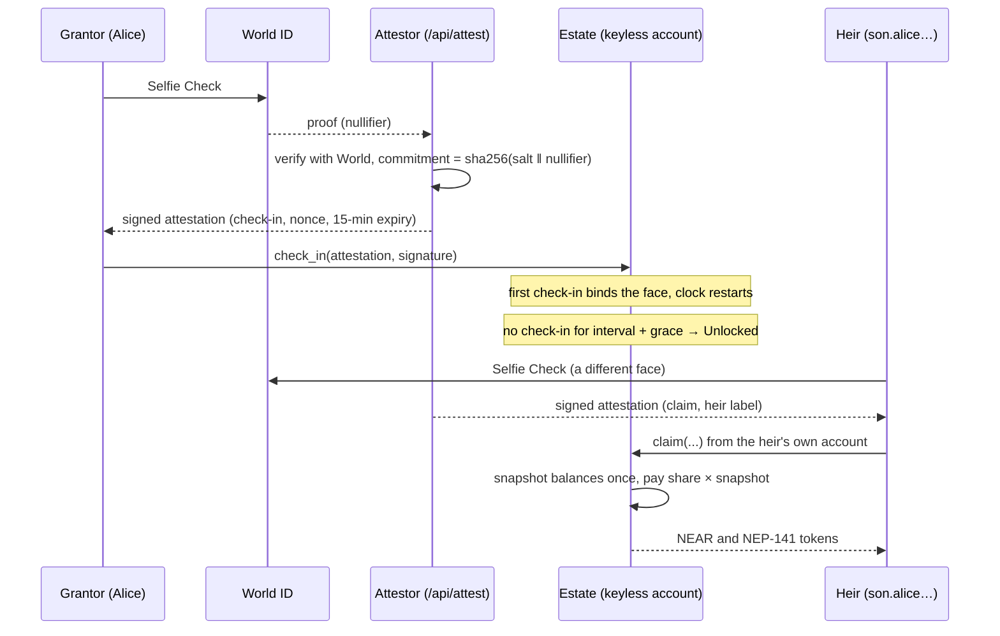

# Herit

> A crypto estate that no key can open. It stays locked while you prove, by selfie, that you're alive, and unlocks to your heirs when you stop.

**NEAR HACKATHON 2026** · Tracks: NFTs That Do Something (`nfts`), Real-World Money (`realworld`), Open Innovation (`open`) · Built on NEAR testnet

[Live app](https://herit-near-bpx6.vercel.app) · [Every estate opened so far](https://herit-near-bpx6.vercel.app/#estates) · [Deployments](#deployments) · [Proof it ran](#proof-it-ran) · [Hackathon diff](#what-was-built-during-the-hackathon)

---

## The problem

Ada holds savings in a self-custody wallet. If she dies tomorrow, they die with her: nobody else has the key. The usual fixes all hand someone a key. She can write down her seed phrase, which anyone who finds it can spend today. She can use a custodian, who can freeze it or be hacked. Or she can use a "dead man's switch" that unlocks if she stops signing, which anyone holding her phone can keep signing for her.

Herit gives the money to an account that has **no keys at all**. Only Ada's face keeps it locked, and only her heirs, each from their own account and with their own face, can collect it.

## How it works

This is the real run on testnet, `alice.herit-near.testnet` (every transaction is in [Proof it ran](#proof-it-ran)). The clock was 2 minutes plus 1 minute of grace so it could finish in a demo; a real estate would use months.

1. **Alice opens an estate.** The factory `herit-near.testnet` creates `alice.herit-near.testnet`: a new NEAR account with **no access key**, running the estate code that was published once as an immutable Global Contract. Nobody can redeploy it, delete it or sign for it: not Alice, not us.
2. **She names two heirs.** Her son gets 60%, her daughter 40%. Each becomes a real account under the estate, `son.alice.herit-near.testnet`, holding a key only the son has. Each heir also gets a **soulbound NEP-171 credential** that reads `locked`.
3. **She funds it.** 3 NEAR and 10 mUSDC (a test stablecoin). For mUSDC she lowers her son's share to 25%.
4. **She checks in with a World ID Selfie Check.** World verifies the selfie; the attestor turns the World nullifier into a salted commitment and signs `{action, commitment, nonce, expiry}`. The estate checks the ed25519 signature. The first check-in binds her face commitment, and every later check-in, and every withdrawal (she takes back 0.5 NEAR), must come from the same face.
5. **She stops checking in.** Three minutes later the estate reads `Unlocked` with nobody sending a transaction: status is computed from the clock. Both credentials now read `claimable` in any wallet or explorer.
6. **The son claims** from his own account with his own Selfie Check. It can't be Alice's face, and one human gets one heir slot. His claim freezes a snapshot of every balance, then pays him **1.49903 NEAR (60%) and 2.5 mUSDC (25%)**.
7. **The daughter claims** later and gets **0.99935 NEAR and 4 mUSDC**: 40% of the same snapshot, whoever went first. The 3.5 mUSDC nobody was given stays in the estate. Both credentials now read `claimed`.



## What makes this different

- **No key exists, so no key can leak.** Seed-phrase backups, multisigs and custodians all keep a key that can move the money before death. Here the estate account has no access key, and runs code published by hash that nobody can change. The only ways out are the grantor's own face (withdraw) or the heirs' own faces after unlock (claim).
- **Liveness is a face, not a signature.** A dead man's switch that asks you to sign every month is fooled by anyone with your phone or your key. Herit's check-in needs a World ID Selfie Check from the face bound at the first check-in.
- **The heir's right is an NFT that changes as the estate does.** Each heir holds a NEP-171 token that every NEAR wallet and explorer can show. Nothing is stored: the contract computes it from the clock and the payouts on every read, so it moves `locked → grace → claimable → claimed` with no transaction. Every transfer and approval call refuses.
- **The heir doesn't need to be a crypto user yet.** The grantor can name an account the heir already has, or the heir makes a key in the browser, sends only the public half, and the estate creates `<label>.<estate>` for them, funded with 0.1 NEAR for gas.
- **Fair whoever claims first.** Shares are measured against one snapshot taken at unlock, so heirs claiming on different days split the same total.

## Architecture

```
near/contracts/herit-estate     the estate: clock, attestations, heirs, vault, claims, NEP-171 credential
near/contracts/herit-factory    opens keyless estates on the published estate code
near/contracts/mock-ft          mUSDC, a NEP-141 test stablecoin
near/attestor-worker            the attestor as an OutLayer worker, for mainnet
frontend/                       Next.js app: setup, dashboard, heirs, claim, explorer, /api/attest
```

### Estate ([`herit-estate/src/lib.rs`](https://github.com/FemiOje/herit-near/blob/c039bc0a3d579e53925e414e90fb97ad886bcfc1/near/contracts/herit-estate/src/lib.rs))

One contract per estate, on its own keyless account. Status is `Active → Grace → Unlocked`, computed from the last check-in, so it never needs a keeper ([`poke_expiry`](https://github.com/FemiOje/herit-near/blob/c039bc0a3d579e53925e414e90fb97ad886bcfc1/near/contracts/herit-estate/src/lib.rs#L254-L278) only stores what the clock already says). [`check_in`](https://github.com/FemiOje/herit-near/blob/c039bc0a3d579e53925e414e90fb97ad886bcfc1/near/contracts/herit-estate/src/lib.rs#L236-L252) verifies the attestor's ed25519 signature, the action, the expiry and a never-used nonce, then binds or matches the face commitment. Heirs are created as sub-accounts by [`add_heir`](https://github.com/FemiOje/herit-near/blob/c039bc0a3d579e53925e414e90fb97ad886bcfc1/near/contracts/herit-estate/src/lib.rs#L603-L650) or named by [`add_heir_account`](https://github.com/FemiOje/herit-near/blob/c039bc0a3d579e53925e414e90fb97ad886bcfc1/near/contracts/herit-estate/src/lib.rs#L652-L695). The vault holds NEAR and NEP-141 tokens. [`claim`](https://github.com/FemiOje/herit-near/blob/c039bc0a3d579e53925e414e90fb97ad886bcfc1/near/contracts/herit-estate/src/lib.rs#L463-L576) takes the snapshot on the first claim, debits each payout before sending it, and credits it back if the transfer fails.

### Credential ([`herit-estate/src/nft.rs`](https://github.com/FemiOje/herit-near/blob/c039bc0a3d579e53925e414e90fb97ad886bcfc1/near/contracts/herit-estate/src/nft.rs))

The NEP-171 views (`nft_token`, `nft_tokens`, `nft_tokens_for_owner`, …) with `nft_mint` and `nft_burn` events. The state comes from [`credential_state`](https://github.com/FemiOje/herit-near/blob/c039bc0a3d579e53925e414e90fb97ad886bcfc1/near/contracts/herit-estate/src/nft.rs#L202-L217), and the image is one of four SVGs on IPFS, chosen by state and pinned by content hash. The [transfer and approval methods](https://github.com/FemiOje/herit-near/blob/c039bc0a3d579e53925e414e90fb97ad886bcfc1/near/contracts/herit-estate/src/nft.rs#L141-L199) exist so wallets get a clear refusal.

### Factory ([`herit-factory/src/lib.rs`](https://github.com/FemiOje/herit-near/blob/c039bc0a3d579e53925e414e90fb97ad886bcfc1/near/contracts/herit-factory/src/lib.rs#L105-L138))

`open_estate` sends one all-or-nothing batch: create the account, fund it, attach the Global Contract by hash, call `new` with the caller as grantor. It adds no key. If anything fails, the grantor gets the whole deposit back. The factory also lists every estate, which the app's explorer reads.

### Attestor ([`frontend/lib/attest.ts`](https://github.com/FemiOje/herit-near/blob/c039bc0a3d579e53925e414e90fb97ad886bcfc1/frontend/lib/attest.ts), [`near/attestor-worker`](https://github.com/FemiOje/herit-near/tree/c039bc0a3d579e53925e414e90fb97ad886bcfc1/near/attestor-worker))

On testnet a Next.js route verifies the Selfie Check with World's API and signs with a server key. It refuses any proof that isn't exactly one Selfie Check, World ID 3.0, for this estate's action (`herit:<label>`), so one human always maps to one commitment. The same rules are built as an OutLayer worker, so on mainnet the key lives in a TEE and nobody holds it. The contract doesn't change between the two.

### Frontend ([`frontend/`](https://github.com/FemiOje/herit-near/tree/c039bc0a3d579e53925e414e90fb97ad886bcfc1/frontend))

Next.js 16. Wallets through HOT's `near-connect`; every read straight from NEAR RPC; the activity feed from FastNEAR's transaction API. The setup wizard sends open → first check-in → heirs → deposit as one wallet approval, worked out from what's already on chain, so a setup that stops halfway resumes.

## Deployments

All on NEAR testnet. The contracts are reproducible builds (`sourcescan/cargo-near:0.21.1-rust-1.96.1`), so the code hash can be checked against this source.

| What | Account or hash |
|---|---|
| Factory | [`herit-near.testnet`](https://testnet.nearblocks.io/address/herit-near.testnet) |
| Estate code, Global Contract (current) | `65rC6sBJGosXHCGC6ityR3poJ68ecHDZsNRAPZQjkX2p`, published in [`rJEwbyoU…`](https://testnet.nearblocks.io/txns/rJEwbyoU9pQQz9W7xN52AoCPDKYx2aoPdY53eZFKTBR) |
| Estate code, first version (estates opened before named heirs) | `87NJpRzyMsaL4WWYspngjbHoLBKPJSjiyrFEpDKXNgE8`, published in [`FvSiTJ2W…`](https://testnet.nearblocks.io/txns/FvSiTJ2W6etG8qX9Yx7iW8qxVE6AxTBEx52D3Ft5uHJ9) |
| mUSDC (NEP-141 test token, 6 decimals) | [`mock-usdc-kaykay.testnet`](https://testnet.nearblocks.io/address/mock-usdc-kaykay.testnet) |
| Web app | [herit-near-bpx6.vercel.app](https://herit-near-bpx6.vercel.app) |

## Proof it ran

**A whole estate, opened through the factory and claimed by both heirs** (`alice.herit-near.testnet`, run by [`near/scripts/smoke-testnet.sh`](near/scripts/smoke-testnet.sh)):

| Step | Transaction |
|---|---|
| Alice opens the estate through the factory | [`56a5W8St…`](https://testnet.nearblocks.io/txns/56a5W8StD9NC5CXtHCwMP3xwz6XKvG78hYD7wpAfhfqm) |
| Son added: his account is created and his credential minted | [`2J1LxqBp…`](https://testnet.nearblocks.io/txns/2J1LxqBp7ZBffc9zqGsTdnufwN65djfhmMyPSSFtdJLg) |
| Daughter added | [`EGJjZ6hh…`](https://testnet.nearblocks.io/txns/EGJjZ6hhx3p1TPfNJt3TBTnqtQWz1876XfpSVrPfUszS) |
| 3 NEAR deposited | [`BRMH7Uz7…`](https://testnet.nearblocks.io/txns/BRMH7Uz7sphkozW45RKoCTEruzrLMBSScA4GfxExqd1z) |
| 10 mUSDC deposited with `ft_transfer_call` | [`De1Qs78K…`](https://testnet.nearblocks.io/txns/De1Qs78KtLyLTbefjcJkWDkdtLFW2cnjCDn18auZVfBH) |
| Son's mUSDC share set to 25% | [`F7fxJbCU…`](https://testnet.nearblocks.io/txns/F7fxJbCUVMEvebt4mEdT848VAeJ9HUABvL8HbQyBZmgP) |
| First check-in binds Alice's face and starts the clock | [`EG4JCk3C…`](https://testnet.nearblocks.io/txns/EG4JCk3ChiE2C7dpCfER1NktvJWfPz4SzoctbdWj8Qj6) |
| Alice withdraws 0.5 NEAR with a fresh attestation | [`CRVET1Rb…`](https://testnet.nearblocks.io/txns/CRVET1Rbb1hxMJvDRQMDwknSVreVxZKw2AzqWAYNLmPN) |
| Son claims: unlock, snapshot, 1.49903 NEAR and 2.5 mUSDC paid | [`576wFUGR…`](https://testnet.nearblocks.io/txns/576wFUGRt8CJaFNj3VzUaJ2ERAT4TCPnxPLP4DX6mseE) |
| Daughter claims: 0.99935 NEAR and 4 mUSDC paid | [`2KavSpcd…`](https://testnet.nearblocks.io/txns/2KavSpcdTV5hxeDUh9e5ebbTCz5REQL5Vce3B8u5VWsh) |

**Real Selfie Checks, and estates run through the web app:**

| Step | Transaction |
|---|---|
| A real Selfie Check accepted as a `check_in` (`spike.herit-near.testnet`) | [`4MR22kUJ…`](https://testnet.nearblocks.io/txns/4MR22kUJqDaHhCgpNARGXTENg3JuNW2byAwEynsyxiHS) |
| A second Selfie Check by the same person matches the bound face | [`8n7WT6uB…`](https://testnet.nearblocks.io/txns/8n7WT6uBJR1n7SMxT7jXLH6tckqhuMpxHk3ic5YExuGT) |
| `kay.herit-near.testnet`: check-in from the setup wizard | [`DF7ZXDpe…`](https://testnet.nearblocks.io/txns/DF7ZXDpe9AePM3FzcQJhoNeFMEffwdt6m4w7LWqVpxyL) |
| …a named heir, `kay-cousin-kaykay.testnet`, claims NEAR and mUSDC from their own wallet | [`7UJnn88i…`](https://testnet.nearblocks.io/txns/7UJnn88iX5f4naW5gAToi862Jyswm8Kiu3XGNuSbQHHk) |
| `keytest.herit-near.testnet`: a key heir claims by loading their key file in the browser | [`CwePayHh…`](https://testnet.nearblocks.io/txns/CwePayHhLZ31BWHUaTwbL4VLWtYsRkzw9njGBnZHhHuD) |

## Try it

### In two minutes, with no wallet

1. Open [herit-near-bpx6.vercel.app/#estates](https://herit-near-bpx6.vercel.app/#estates). You see every estate the factory has opened, read live from chain: status, unlock time, heirs, vault, and each estate's credential NFT image in its current state.
2. Click the `alice.herit-near.testnet` row. Both heirs show credential `claimed`.
3. Click **heir view** on `son`. You see his paid share and his credential card with the `claimed` image.
4. Open [`/api/activity?estate=alice.herit-near.testnet`](https://herit-near-bpx6.vercel.app/api/activity?estate=alice.herit-near.testnet). You see the estate's events as JSON, each with its transaction hash.
5. Check a credential on chain yourself:
   ```bash
   near contract call-function as-read-only alice.herit-near.testnet nft_token json-args '{"token_id":"son"}' network-config testnet now
   ```
   The `extra` field reads `"state":"claimed"`.

### The whole flow

You need two testnet accounts (create them free in [Meteor](https://wallet.meteorwallet.app) or HOT), and **two people** with the [World App](https://world.org/world-app) and a Selfie Check: the grantor and the heir must be different faces, by design.

1. **Grantor:** connect a wallet, open **open an estate**. Name it, pick the 2 min + 1 min clock, add the second account as an heir (you see the `locked` credential preview), put 0.5 NEAR in the vault. Do the Selfie Check in the World App, then approve one wallet transaction. You see the dashboard with the clock running.
2. **Grantor:** open **heirs**. You see the heir with their credential image and `credential: locked`.
3. Wait three minutes without checking in. On the home page explorer, the estate's NFT image changes to `claimable`.
4. **Heir:** connect the heir account, open **claim**. You see the estate listed. Open it, press **selfie check and claim**, approve. You see the payout land and the credential turn `claimed`.

## Quick start

Prerequisites: Rust 1.96 with the `wasm32-unknown-unknown` target, [`cargo-near`](https://github.com/near/cargo-near) 0.21+, Node 20+ and pnpm.

```bash
git clone https://github.com/FemiOje/herit-near.git && cd herit-near

# Contracts: build the wasm the sandbox tests load, then run every test
cd near
for c in herit-estate herit-factory mock-ft test-global-publisher; do
  (cd contracts/$c && cargo near build non-reproducible-wasm)
done
cargo test --workspace          # unit, fuzz, invariant and sandbox tests
cd ..

# Frontend
cd frontend
pnpm install
cp .env.example .env.local
pnpm dev                        # http://localhost:3000
```

> With no server values in `.env.local`, every read works locally: the explorer, dashboards, heir views and activity feed of the live testnet estates. The Selfie Check routes need a World ID app with Selfie Check enabled, and an attestor key; estates opened through `herit-near.testnet` only accept the factory's attestor key, so use the [live app](https://herit-near-bpx6.vercel.app) for the write flow.

## Testing

All passing on the commit this README describes:

| Suite | Tests | What |
|---|---|---|
| Estate unit, fuzz and invariant (`cargo test -p herit-estate`) | 181 | Every method, plus `proptest` properties over random inputs and random call sequences |
| Factory unit and fuzz | 15 | The open batch, its rollback, listing, the attestor and code switches |
| mUSDC | 3 | The test token |
| Sandbox ([`near/tests/`](near/tests/)) | 38 | A real local NEAR node running the release wasm: check-ins, heirs as real accounts, the vault with real NEP-141 transfers, claims, the credential, the factory with a published Global Contract, and one whole lifecycle |
| Frontend (`pnpm test`) | 58 | Attestation checks against a recorded World reply, transaction building, setup resumption, heir discovery, key files, credential state |

The invariants, checked after every step of random call sequences (`proptest`):

- An estate that has unlocked never locks again, and one that was never checked in never lapses.
- A nonce is accepted once; a check-in with a bad expiry or after unlock is never accepted.
- One account holds at most one heir slot, shares never pass 100%, and there are never more than 10 heirs.
- The vault's balance is always deposits minus withdrawals that are in flight or went through; a failed transfer gives its amount back.
- After every heir claims, in any order, with failed payouts retried, each was paid exactly their rounded-down share of the snapshot, the total never exceeds the snapshot, and the books hold the rest.
- The credentials are exactly the created heirs, each owner holds exactly one, and every page of `nft_tokens` joins up into the full list.

## Known issues

- **An heir's gas has to be held up front.** NEAR reserves attached gas at a pessimistic price (about 0.1 NEAR per 100 Tgas) and refunds the rest afterwards, so a key heir's 0.1 NEAR seed can attach about 80 Tgas. A claim costs about 15 Tgas plus 5 per NEAR payout and 25 per token payout, which fits NEAR and two tokens. The app sizes the gas to the estate's assets, and anyone can send an heir more NEAR. The seed is in the published code; mainnet needs a larger seed or claims split across calls.
- **On testnet the attestor key sits on our server.** The Next.js route holds it in an environment variable, so we are trusted not to sign false check-ins. The OutLayer worker with the same rules is built and tested for mainnet, where the key lives in a TEE. A new attestor only reaches estates opened afterwards: estates are keyless and keep theirs.
- **The Selfie Check needs a second human to test claims.** The contract refuses a claim made with the grantor's face, and a person gets one heir slot per estate. A judge on their own can test the grantor side and every read, and see the claim side in [Proof it ran](#proof-it-ran).
- **The published code is fixed.** The estate code is an immutable Global Contract, so a bug fix means publishing new code that only new estates use. Estates opened on the first version, such as `alice`, can't name existing accounts as heirs.

## Track alignment

| Track criterion | Where this submission meets it |
|---|---|
| **NFTs That Do Something:** "NFTs as accounts — assets that … carry credentials, memberships or access rights. Ownership with behavior." DYNAMIC NFTS, NEP-171, SUB-ACCOUNTS | The heir credential is a NEP-171 token whose state is computed live from the estate ([`nft.rs#L202-L217`](https://github.com/FemiOje/herit-near/blob/c039bc0a3d579e53925e414e90fb97ad886bcfc1/near/contracts/herit-estate/src/nft.rs#L202-L217)); it is the heir's claim right; heirs are sub-accounts of the estate, which is a sub-account of the factory |
| **Real-World Money:** "Something a normal company could use tomorrow." STABLECOINS | Inheritance of NEAR and any NEP-141 stablecoin, with per-asset shares, paid straight to the heirs' accounts ([`claim`](https://github.com/FemiOje/herit-near/blob/c039bc0a3d579e53925e414e90fb97ad886bcfc1/near/contracts/herit-estate/src/lib.rs#L463-L576)) |
| **Open Innovation:** "new ways for money, intelligence and ownership to work together" | Keyless accounts on published Global Contract code, unlocked by proof of life rather than by a key |

## What was built during the hackathon

Herit started at ETHOnline 2026 as a Solidity app on Sepolia (ENSv2 subnames and World ID), at [Kelechikizito/herit](https://github.com/Kelechikizito/herit). That version is the baseline and is not judged. Everything on NEAR was written from 2026-11-08 to 2026-11-12, after the `pre-hackathon` tag, on a branch that first deleted the Ethereum code: the Rust contracts, the attestor and its OutLayer worker, the tests and the new frontend.

- Baseline: tag [`pre-hackathon`](https://github.com/FemiOje/herit-near/tree/pre-hackathon)
- Everything since: [`pre-hackathon...main`](https://github.com/FemiOje/herit-near/compare/pre-hackathon...main)
- Design notes and every checkpoint with its tests and transactions: [`herit-docs/`](herit-docs/)

## Tech stack

| Layer | What |
|---|---|
| Contracts | Rust, `near-sdk` 5.30.1, `near-contract-standards` (NEP-171 types), Global Contracts, reproducible builds with `cargo-near` |
| Tests | `cargo test`, `proptest`, `near-workspaces` sandbox |
| Liveness | World ID Selfie Check (`@worldcoin/idkit` 4.2.3), verified by our attestor |
| Attestor for mainnet | OutLayer worker (`wasm32-wasip2`) |
| Frontend | Next.js 16, React 19, TanStack Query, Tailwind 4, `near-api-js` 7, HOT `near-connect` |
| Data | NEAR RPC (FastNEAR), FastNEAR transaction API, Pinata IPFS for the credential images |

Libraries are used as published. Code was written by the team with Claude Code (Anthropic) as a coding assistant.

## What we'd build next

**Reminders** by email and browser push before each deadline. A missed reminder can never cause an unlock, because only the contract decides that. **More assets:** NFTs assigned to a named heir, and BTC, ETH and SOL held as NEAR Intents balances and paid out in the same split. **Mainnet:** the OutLayer attestor, a larger heir seed, and a smaller estate wasm, since a Global Contract's cost is per byte.

## Team · License

Built by [Kelechikizito](https://github.com/Kelechikizito) and [jinius](https://github.com/FemiOje).

Disclosure (rule Q-015): Kelechikizito also submitted a separate, independent project to NEAR HACKATHON, [Bizzy-Fy](https://github.com/Kelechikizito/bizzy-fy), built alone. The two share no code.

[MIT](LICENSE)
