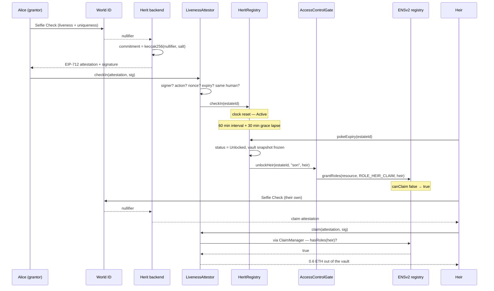

# Herit

> Your heirs hold ENS subnames that cannot claim your assets, until you(the grantor) stop proving, with your face(World Selfie Check), that you are alive.

**ETHOnline 2026** · World track & ENS track · World ID Selfie Check + ENSv2 Enhanced Access Control

[Live app](https://herit-psi.vercel.app/) · [Deployed contracts](#deployments) · [Verify it yourself](#proof-it-ran)

<!-- Demo video: paste the URL here, then add it to the link row above. -->

---

## The problem

Alice holds 40 ETH and a `.eth` name. If she dies, her daughter gets nothing. Her seed phrase is in a drawer. Her private keys are in the basement. Alice looks at a dead-man's-switch contract, and finds problems.

The switch's proof of life is a timestamp. Any transaction refreshes it. A bot on a cron job refreshes it. **The thief who stole her key refreshes it**, and the contract concludes Alice is fine while her estate is drained.

The switch's heirs are addresses in an array. `0x93923B…D27A0` has no verifiable link to her daughter, no link to a unique human at all, and nothing stops one person from occupying four of the five heir slots.

Herit solves both problems. Proof of life becomes a World Selfie Check, a live face, bound to one human. The heir becomes an ENS subname that holds a role in the real registry.

## How it works

Alice opens an estate at `alice.herit.eth` and wills 1 ETH of her 40 into it. Her check-in interval is 90 days, her grace period 14 days.

1. **She registers her heirs.** `son.alice.herit.eth` gets 6000 basis points(60%), `daughter.alice.herit.eth` gets 4000(40%). Each is a real ENSv2 subname in a registry deployed for this estate alone. Each carries text records anyone can read: `herit.relationship` = `son`, `herit.share` = `6000`.
2. **She checks in with her face.** IDKit raises a Selfie Check. World returns a nullifier, stable for one particular human, different for everyone else. The backend salts it into a commitment and signs an EIP-712 attestation. `LivenessAttestor` on Sepolia checks the signature and binds the estate to that commitment.
3. **Her key gets stolen at 45th day.** Although, the thief holds the private key and can sign anything, they still cannot check in: their Selfie Check produces a different nullifier, so `checkIn` reverts `LivenessAttestor__WrongHuman`. A timestamp switch would have been fooled here.
4. **90th day passes.** Anyone calls `pokeExpiry()`. Status → `Grace`. Alice can still recover: one Selfie Check within the next 14 days returns the estate to `Active`.
5. **14 days grace passes.** `pokeExpiry()` → `Unlocked`. Three things happen in one transaction: the vault freezes its balances at 1 ETH, the estate name is renewed so no role lands on a lapsed name, and the gate calls `grantRoles(ROLE_HEIR_CLAIM)` on each heir subname. `canClaim` now returns `true`
6. **The son claims.** He passes his own Selfie Check. `ClaimManager` asks ENS whether he holds `ROLE_HEIR_CLAIM | ROLE_HEIR_REGISTERED`, gets `true`, and pays him 6000(60%) bps of the frozen 1 ETH: 0.6 ETH. The daughter's 0.4 ETH is still waiting when she comes.



## Architecture

Five contracts on Sepolia, deployed as one nonce sequence. Each holds the others as `immutable` constructor arguments, so they are only ever replaced as a set.

### `AccessControlGate` ([src/AccessControlGate.sol](https://github.com/Kelechikizito/herit/blob/f5b10ebb6b21a2f41843d3e26c94779c0b653bd2/src/AccessControlGate.sol))

The only contract that touches ENS, and the one holding the dangerous privilege. `openEstate` ([L226](https://github.com/Kelechikizito/herit/blob/f5b10ebb6b21a2f41843d3e26c94779c0b653bd2/src/AccessControlGate.sol#L226)) registers `alice.herit.eth` and deploys a `UserRegistry` proxy for that estate alone through ENSv2's `VerifiableFactory` — a three-level hierarchy, `herit.eth` → grantor registry → estate registry. `registerHeir` ([L277](https://github.com/Kelechikizito/herit/blob/f5b10ebb6b21a2f41843d3e26c94779c0b653bd2/src/AccessControlGate.sol#L277)) mints the heir subname with the claim bit withheld; `unlockHeir` ([L321](https://github.com/Kelechikizito/herit/blob/f5b10ebb6b21a2f41843d3e26c94779c0b653bd2/src/AccessControlGate.sol#L321)) grants it. `canClaim` ([L477](https://github.com/Kelechikizito/herit/blob/f5b10ebb6b21a2f41843d3e26c94779c0b653bd2/src/AccessControlGate.sol#L477)) answers from the registry rather than from Herit storage.

### `HeritRegistry` ([src/HeritRegistry.sol](https://github.com/Kelechikizito/herit/blob/f5b10ebb6b21a2f41843d3e26c94779c0b653bd2/src/HeritRegistry.sol))

The state machine and the share matrix. `_pendingStatus` ([L378](https://github.com/Kelechikizito/herit/blob/f5b10ebb6b21a2f41843d3e26c94779c0b653bd2/src/HeritRegistry.sol#L378)) is the source of truth: the stored `status` field is only a cache that moves on a poke, so every guard reads the computed value instead. That is what stops a grantor whose grace lapsed last week, in an estate nobody has poked, from checking in and erasing the heirs' pending claim. `_unlock` ([L302](https://github.com/Kelechikizito/herit/blob/f5b10ebb6b21a2f41843d3e26c94779c0b653bd2/src/HeritRegistry.sol#L302)) renews, snapshots and grants in that order.

### `LivenessAttestor` ([src/LivenessAttestor.sol](https://github.com/Kelechikizito/herit/blob/f5b10ebb6b21a2f41843d3e26c94779c0b653bd2/src/LivenessAttestor.sol))

The World ID boundary. Verifies an EIP-712 `Attestation{estateId, subject, action, heirLabelhash, commitment, nonce, expiry}` against the backend's single-purpose signer, then forwards. `checkIn` ([L94](https://github.com/Kelechikizito/herit/blob/f5b10ebb6b21a2f41843d3e26c94779c0b653bd2/src/LivenessAttestor.sol#L94)) binds the estate to the first commitment it sees and rejects every later one that differs. `claim` ([L119](https://github.com/Kelechikizito/herit/blob/f5b10ebb6b21a2f41843d3e26c94779c0b653bd2/src/LivenessAttestor.sol#L119)) refuses a commitment already spent on this estate, and refuses the grantor's own commitment — one human cannot be both the deceased and the heir. Attestations expire in 30 minutes maximum, whatever the backend asks for.

### `HeritVault` ([src/HeritVault.sol](https://github.com/Kelechikizito/herit/blob/f5b10ebb6b21a2f41843d3e26c94779c0b653bd2/src/HeritVault.sol))

Opt-in escrow for willed ETH and ERC20s — not a module over the grantor's whole wallet. `snapshot` ([L208](https://github.com/Kelechikizito/herit/blob/f5b10ebb6b21a2f41843d3e26c94779c0b653bd2/src/HeritVault.sol#L208)) freezes balances at the unlock transition, not at the first claim, so a deposit landing between two heirs' claims cannot change what a share means. It is idempotent, because `pokeExpiry` is permissionless and two callers can land in the same block.

### `ClaimManager` ([src/ClaimManager.sol](https://github.com/Kelechikizito/herit/blob/f5b10ebb6b21a2f41843d3e26c94779c0b653bd2/src/ClaimManager.sol))

Heir payout. `claim` ([L73](https://github.com/Kelechikizito/herit/blob/f5b10ebb6b21a2f41843d3e26c94779c0b653bd2/src/ClaimManager.sol#L73)) pokes the registry itself so an heir never has to know unlock was a separate transaction, checks status, asks ENS via `canClaim`, then pays each token once. One heir, one token, paid once.

### The role bitmap ([src/libraries/HeritRolesLib.sol](https://github.com/Kelechikizito/herit/blob/f5b10ebb6b21a2f41843d3e26c94779c0b653bd2/src/libraries/HeritRolesLib.sol))

ENSv2 packs 64 roles into a `uint256` as nybbles; a role at nybble _N_ sits at bit `4N`, its admin counterpart 128 bits higher. `RegistryRolesLib` occupies nybbles 0–9 and 30–31. Herit claims 10 and 11, in the free range, **alongside** ENS's own roles rather than in a system beside them.

```solidity
uint256 internal constant ROLE_HEIR_CLAIM = 1 << 40;              // nybble 10
uint256 internal constant ROLE_HEIR_CLAIM_ADMIN = ROLE_HEIR_CLAIM << 128;
```

## Deployments

Ethereum Sepolia (chain 11155111). All five verified on Etherscan, all deployed in block [11675256](https://sepolia.etherscan.io/block/11675256).

| Contract            | Address                                                                                                |
| ------------------- | ------------------------------------------------------------------------------------------------------ |
| `AccessControlGate` | [`0xA86e42C7…C63103`](https://sepolia.etherscan.io/address/0xA86e42C7250fec7C29cfA09584847B0B24C63103) |
| `HeritRegistry`     | [`0xae63470A…b76207`](https://sepolia.etherscan.io/address/0xae63470A513d3488a42cd877b7ec42f861b76207) |
| `HeritVault`        | [`0xC7EBa4BD…dae0BA`](https://sepolia.etherscan.io/address/0xC7EBa4BD6CE4c4d42C69e4Da8498911c57dae0BA) |
| `ClaimManager`      | [`0xeC3692EA…BD081c`](https://sepolia.etherscan.io/address/0xeC3692EA195EecE5370Ea781208cD98d8DBD081c) |
| `LivenessAttestor`  | [`0x6Ffe6299…4366C`](https://sepolia.etherscan.io/address/0x6Ffe62994e64c0617f4bdfD2c81C8B439324366C)  |

The ENS layer, on the **frozen ENSv2 hackathon set** — not the regular Sepolia beta set, which is a different group of contracts:

| Thing                        | Address                                                                                                |
| ---------------------------- | ------------------------------------------------------------------------------------------------------ |
| `herit.eth` grantor registry | [`0x0Aa2A7d8…E4a21`](https://sepolia.etherscan.io/address/0x0Aa2A7d858bA649B6a794E1fa07ccb97a50E4a21)  |
| `PermissionedResolver`       | [`0x42fA2a15…89EBb1`](https://sepolia.etherscan.io/address/0x42fA2a1582a89E18d0a54d8dC65157172489EBb1) |
| ENSv2 `ETHRegistry`          | [`0x1d78834d…3971e`](https://sepolia.etherscan.io/address/0x1d78834d97c1d7b1a38c1dedbd1a287cfed3971e)  |
| ENSv2 `VerifiableFactory`    | [`0x894bc9cc…07780`](https://sepolia.etherscan.io/address/0x894bc9cc8ff1ad96b8a288c86a8c71d662c07780)  |

Full ENSv2 address set and the selector-level audit of it: [`documents/deployments.md`](documents/deployments.md).

## Quick start

```bash
git clone --recursive https://github.com/Kelechikizito/herit.git
cd herit
forge build
```

```bash
cp .env.example .env       # ETH_SEPOLIA_RPC_URL is required for the fork tests
forge test
```

The frontend is a separate app with its own dependencies:

```bash
cd frontend
npm install
cp .env.example .env.local
npm run dev
```

> `.env.local` needs a World ID app id with **Selfie Check enabled** (a separate flag from sandbox access), plus `ATTESTOR_PRIVATE_KEY` and `NULLIFIER_SALT`. Without them the app reads Sepolia fine but cannot produce an attestation. The attestor key holds no gas and never sends a transaction.

## Security

> [!WARNING]
> **These contracts are unaudited and must not be used in production.** They hold testnet value only, and have had no professional review. see [Known issues](#known-issues).

### Static analysis

Two tools, both run against `src/` at the deployed commit. Full triaged write-ups, finding by finding, are in [`security/static-analysis/`](security/static-analysis/).

| Tool                                           | Version | Findings                                  | Outcome                                                                                       |
| ---------------------------------------------- | ------- | ----------------------------------------- | --------------------------------------------------------------------------------------------- |
| [Slither](security/static-analysis/slither.md) | 0.11.5  | 45 results · 52 contracts · 101 detectors | No vulnerabilities. 1 high and 3 medium are false positives; the rest are accepted by design. |
| [Aderyn](security/static-analysis/aderyn.md)   | 0.6.8   | 8 issues · 1 high, 7 low                  | No vulnerabilities. The high overlaps Slither's reentrancy family; two lows are worth fixing. |

Every finding was checked against the source rather than passed through. The three that look worst are the three that are wrong:

- **`arbitrary-send-eth` (High)** on `HeritVault._send` — it is `internal` with two callers, `withdraw` (`onlyGrantorOf`, `notUnlocked`, sends to `msg.sender`) and `payOut` (`onlyClaimManager`, sends to the heir ENS resolved). `to` is never caller-supplied on an unguarded path.
- **`reentrancy-no-eth` on `ClaimManager.claim`** — reads as a checks-effects-interactions violation and is the opposite. `s_paid` is written at L99, `payOut` is called at L101; the effect precedes the interaction. The "after" in the report refers to the earlier `pokeExpiry` at L80. The function is `nonReentrant` and `onlyAttestor`.
- **`incorrect-equality` (Medium, ×3)** — that detector hunts strict equality against `block.timestamp` or balances. All three compare `Status` enum members or the fee-on-transfer zero guard, where equality is the only correct operator.

Two findings are real and deliberately left for after the hackathon: `nonReentrant` is declared second on `unlockHeir` and `renewEstate`, so the guard is set after the access check (safe today only because that check makes no external call), and two errors are declared but never reverted — `LivenessAttestor__InvalidSigner` and `HeritRegistry__EstateNotFound`.

### Coverage

`forge coverage`, contracts only. Deploy scripts and the ERC20 mocks are omitted.

| File                           | Lines                | Statements           | Branches            | Functions           |
| ------------------------------ | -------------------- | -------------------- | ------------------- | ------------------- |
| `src/HeritVault.sol`           | 92.00% (92/100)      | 92.05% (81/88)       | 66.67% (14/21)      | 100.00% (21/21)     |
| `src/LivenessAttestor.sol`     | 88.24% (45/51)       | 83.64% (46/55)       | 56.25% (9/16)       | 75.00% (6/8)        |
| `src/AccessControlGate.sol`    | 74.23% (72/97)       | 78.85% (82/104)      | 0.00% (0/14)        | 83.33% (15/18)      |
| `src/HeritRegistry.sol`        | 63.75% (102/160)     | 62.58% (102/163)     | 28.12% (9/32)       | 70.97% (22/31)      |
| `src/ClaimManager.sol`         | 62.96% (34/54)       | 56.06% (37/66)       | 13.33% (2/15)       | 50.00% (4/8)        |
| **Repo total** (incl. scripts) | **53.00%** (371/700) | **50.76%** (366/721) | **18.72%** (35/187) | **63.71%** (79/124) |

## Known issues

**The attestor key is the centralization point, and rotating it means redeploying everything.** `LivenessAttestor.I_SIGNER` is `immutable`, and all five contracts hold each other as immutables, so a key rotation replaces the set. A post-deploy setter was rejected deliberately: it would leave a permanent function through which the privileged signer could be repointed. The key is narrow — domain-separated to Herit, holds no funds, holds no gas, and can only assert that a Selfie Check passed. It is the top thing to decentralize.

**Unallocated shares are stranded after unlock.** Shares are not required to sum to 10000 bps, and `HeritVault.withdraw` is gated on `notUnlocked`. If a grantor allocates 90%, the remaining 10% has no path out once the estate unlocks. Truncation adds to it: `payOut` computes `(snapshot * bps) / 10000` and rounds down, returning zero rather than reverting so that one dust-sized share cannot block a whole claim. Chosen over a sweep function, which would have needed a privileged recipient in a contract that deliberately has none.

**Selfie Check cannot be verified on-chain, and the obvious workaround does not apply.** The World ID Router _is_ deployed on Ethereum Sepolia at `0x469449f251692e0779667583026b5a1e99512157` — verified live — but on-chain verification is `groupId = 1`, Orb credentials only. Selfie Check is Cloud Verify-only, which is exactly why it is the right credential here: an Orb proof shows a human is unique, not that they are alive today. So the backend attestor stays in the check-in path. It could be removed from the _heir claim_ path, which is a one-time uniqueness gate rather than a liveness one. Noted as an option, not built.

**Herit's names are invisible in the ENS app.** The official app indexes the regular Sepolia beta set; Herit registers into the frozen hackathon set, a different group of contracts entirely. Looking up `alice.herit.eth` on the ENS website returns nothing no matter how correct the registration is. The chain is the source of truth — read the registry directly, as the commands above do.

## Tech stack

| Layer      | Choice                                                                                                                      |
| ---------- | --------------------------------------------------------------------------------------------------------------------------- |
| Contracts  | Solidity 0.8.30, Foundry, OpenZeppelin (EIP-712, ECDSA, ReentrancyGuard)                                                    |
| Naming     | ENSv2 frozen hackathon set on Sepolia — `PermissionedRegistry`, `UserRegistry`, `PermissionedResolver`, `VerifiableFactory` |
| Identity   | World ID Selfie Check via IDKit + Cloud Verify, bridged to Sepolia by an EIP-712 attestation                                |
| Frontend   | Next.js 16.3.4, React 19, wagmi 3, viem 2, ensjs 4, Tailwind 4                                                              |
| Indexing   | The Graph subgraph (`frontend/subgraph`) for the activity feed; every timer and balance still read live from Sepolia        |
| Automation | `pokeExpiry()` is permissionless — unlock depends on no single party remembering to poke                                    |

## Team · License · Acknowledgements

Built by [Kelechi Kizito Ugwu](https://github.com/Kelechikizito) and [Oluwafemi Ojetokun](https://github.com/FemiOje) for ETHOnline 2026.

MIT.

Thanks to the ENS team for the frozen hackathon deployment and for confirming the Universal Resolver override, and to World for the Selfie Check credential. Design notes and the reasoning behind each decision are in [`ARCHITECTURE.md`](ARCHITECTURE.md); the selector-level audit of the deployed ENSv2 set is in [`documents/deployments.md`](documents/deployments.md).
